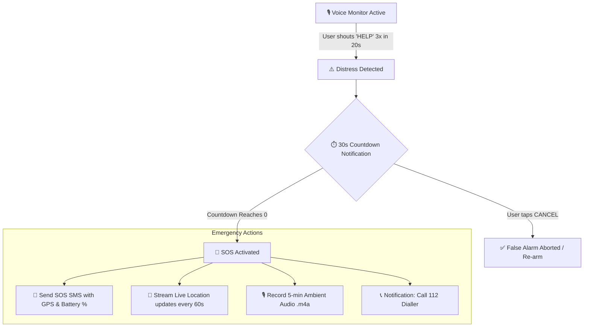

# 🛡️ HELP — Voice-Activated Emergency SOS Assistant

<p align="center">
  
  
  
  
  
</p>

<p align="center">
  <b>A lightweight, hands-free personal safety guardian for Android.</b><br>
  Listens for distress triggers, provides a failsafe cancellation countdown, broadcasts emergency alerts with live GPS and battery telemetry, and archives ambient audio evidence.
</p>

---

## ⚡ Highlights

- 🗣️ **Hands-Free Trigger** — Continuous voice monitoring detects repeated "HELP" distress calls (3x in 20 seconds).
- ⏱️ **30-Second Grace Period** — Visual countdown notification with instant 1-tap `CANCEL` to eliminate accidental false alarms.
- 📡 **Automated SMS Dispatch** — Sends instant SOS messages to multiple designated contacts with Google Maps coordinates and battery levels.
- 📍 **Continuous GPS Beacon** — Periodically transmits real-time location updates every 60 seconds while emergency mode remains active.
- 🎙️ **Silent Audio Evidence** — Automatically captures up to 5 minutes of ambient AAC audio stored securely in app storage.
- 🚨 **One-Tap Emergency Dialler** — Instant heads-up notification launches the dialler preloaded with emergency services (`112`).
- 🔋 **Foreground Service Architecture** — Designed to stay alive in the background with persistent status indicators.

---

## 🔄 How It Works



---

## 📱 User Workflow

| Stage | What Happens | Safety Mechanism |
| :--- | :--- | :--- |
| **1. Standby** | Foreground service listens continuously via `SpeechRecognizer`. | Minimal battery impact, persistent status icon in tray. |
| **2. Trigger** | Word counter tallies distress phrases within a 20-second sliding window. | Requires 3 deliberate cues to minimize ambient false triggers. |
| **3. Grace Period** | 30-second heads-up timer runs on high-priority notification channel. | 1-tap `CANCEL` button immediately halts dispatch. |
| **4. Broadcast** | Sends SMS to all saved contacts: timestamp, battery %, and Google Maps link. | Direct cellular telephony without third-party server dependency. |
| **5. Evidence** | Background `MediaRecorder` buffers ambient sound to local storage. | Up to 5 minutes saved in app-specific directory. |
| **6. Dispatch** | Heads-up prompt opens device dialler prefilled with `112`. | Places user one tap away from first responders. |

---

## 🛠️ Tech Stack & Architecture

- **Language:** Kotlin (JVM 17 target)
- **Minimum Android Version:** Android 8.0 (API level 26 - Oreo)
- **Target Android Version:** Android 15 (API level 35)
- **Core Components:**
  - `MainActivity` — Contact management & dynamic multi-permission dispatcher.
  - `HelpMonitorService` — Long-running foreground service with `microphone` & `location` permissions.
  - `SpeechRecognizer` — On-device speech detection with offline preference fallback.
  - `MediaRecorder` — MPEG-4 / AAC high-fidelity audio recorder.
  - `SmsManager` & `LocationManager` — Direct carrier SMS messaging & GPS telemetry.

---

## 📂 Project Structure

```text
help/
├── app/
│   ├── src/main/
│   │   ├── java/com/help/sos/
│   │   │   ├── MainActivity.kt        # Setup UI, contacts storage & permission handling
│   │   │   └── HelpMonitorService.kt  # Foreground daemon, voice trigger & emergency logic
│   │   └── AndroidManifest.xml        # Permissions, service types & intent filters
│   └── build.gradle.kts               # App module build config & dependencies
├── gradle/                            # Gradle wrapper configuration
├── build.gradle.kts                   # Root build script
├── settings.gradle.kts                # Project configuration
└── README.md                          # You are here!
```

---

## 🚀 Getting Started

### Prerequisites

- **Android Studio** (Ladybug / Jellyfish or newer recommended)
- **Android SDK Platform 35**
- **JDK 17**
- **A physical Android device** *(Crucial: background microphone access and cellular SMS cannot be tested reliably on emulators)*

### Installation & Build

1. **Clone the repository:**
   ```bash
   git clone https://github.com/ayush-puri1/HELP.git
   cd HELP
   ```

2. **Open in Android Studio:**
   - Select **Open an Existing Project** and choose the cloned repository directory.
   - Allow Gradle to sync dependencies.

3. **Build the Debug APK via CLI:**
   ```bash
   # Windows
   .\gradlew.bat assembleDebug

   # macOS / Linux
   ./gradlew assembleDebug
   ```
   The APK will be generated at `app/build/outputs/apk/debug/app-debug.apk`.

4. **Deploy to Device:**
   Connect your physical phone via USB debugging and run:
   ```bash
   adb install -r app/build/outputs/apk/debug/app-debug.apk
   ```

---

## 🔑 Permissions & Security

HELP requests only the essential hardware and communication capabilities necessary to protect you in an emergency:

| Permission | Purpose |
| :--- | :--- |
| `RECORD_AUDIO` | Voice trigger recognition & ambient safety audio recording |
| `ACCESS_FINE_LOCATION` | Accurate GPS coordinates embedded in SOS alerts |
| `SEND_SMS` | Direct carrier message dispatch to trusted contacts |
| `POST_NOTIFICATIONS` | Ongoing status bar indicator & 30-second cancellation interface |
| `FOREGROUND_SERVICE_*` | Prevents the operating system from killing the monitor in background |

> [!NOTE]
> All emergency contacts and audio evidence are stored **locally on device** in private application storage. No personal data, recordings, or telemetry are transmitted to third-party servers.

---

## ⚠️ Important Safety Notice & Limitations

> [!IMPORTANT]
> **This project is currently an engineering prototype/MVP.**
> - **In immediate real-life danger, dial your national emergency number directly (`112` / `911` / `999`).**
> - **Speech Recognition:** Android's built-in `SpeechRecognizer` may time out or get throttled by aggressive OEM power-saving modes (MIUI, OneUI, ColorOS).
> - **Direct Calling:** Android security policy prevents third-party apps from auto-dialing emergency numbers without direct user confirmation; the app opens the dialler for user safety.

---

## 🗺️ Roadmap to Production

- [ ] Integrate a dedicated, lightweight offline wake-word model (e.g., Vosk, Picovoice Porcupine, or open WakeWord).
- [ ] Migrate from `LocationManager` to Google Play Services `FusedLocationProviderClient` for higher precision and indoor fixes.
- [ ] Add AES-256 encryption for saved audio evidence files.
- [ ] Implement a safe "Test Simulation Mode" allowing end-to-end rehearsal without dispatching real SMS or dialler alerts.
- [ ] Custom trigger word customization (e.g., custom safe words or stealth duress phrases).
- [ ] Modern Jetpack Compose UI overhaul with Material 3 styling and contact picker integration.

---

## 🤝 Contributing

Contributions are what make the open-source community such an amazing place to learn, inspire, and create. Any contributions you make are **greatly appreciated**!

1. Fork the Project
2. Create your Feature Branch (`git checkout -b feature/AmazingFeature`)
3. Commit your Changes (`git commit -m 'Add some AmazingFeature'`)
4. Push to the Branch (`git push origin feature/AmazingFeature`)
5. Open a Pull Request

---

## 📄 License

Distributed under the **MIT License**. See `LICENSE` for more information.

<p align="center">
  Made by Sawan for personal safety & emergency responsiveness.
</p>
